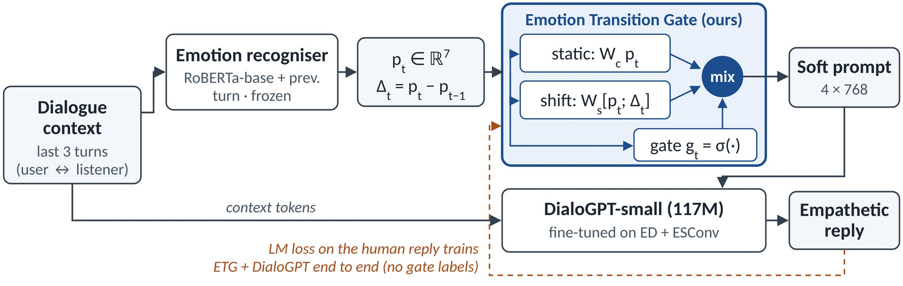

# EmoDial

**Emotion-aware empathetic dialogue with an Emotion Transition Gate (ETG).**
CS425 Generative AI for Natural Language Communication · Group 1 (G1T1) · SMU, AY2026/27 Term 1



A frozen emotion recogniser gives the user's emotion distribution `p_t` for every user turn.
ETG looks at how it changed since the previous user turn (`Δ_t = p_t − p_{t−1}`) and learns,
per turn, how much the reply should depend on that change:

```
g_t = σ( w_g · [ ‖Δ_t‖₁ ; p_t ] + b_g )                       (1)
s_t = (1 − g_t) · W_c p_t  +  g_t · W_s [ p_t ; Δ_t ]          (2)
```

`s_t` becomes 4 soft-prompt vectors (4 × 768) in front of DialoGPT-small's context embeddings.
The proposal is in [`docs/proposal.pdf`](docs/proposal.pdf).

## Systems compared

| System | Emotion input | Answers |
|---|---|---|
| `b0` | none | emotion-blind baseline (RQ1) |
| `b1` | static prompt `W_c p_t` (g = 0) | current-emotion conditioning (RQ1, RQ2) |
| `etg_nodelta` | ETG with `Δ_t` fixed to 0 | is the gain just extra parameters? (RQ2) |
| `etg_nogate` | g fixed to 1 | does the learned gate matter? (RQ2) |
| `etg` | full model | proposed (RQ2, RQ3) |

All five start from the **same** fine-tuned checkpoint and train for the same number of steps,
so differences come only from the emotion input.

## Repository layout

```
configs/default.yaml      all settings (full runs); configs/smoke.yaml = tiny CPU test run
emodial/
  emotions.py             the shared 7-class label space (same order as the judge model)
  data/                   download + parsers (ED, ESConv, DailyDialog, MELD) -> JSONL
  recogniser/model.py     RoBERTa classifier over (previous turn, current utterance)
  generator/etg.py        EmotionPrompt: b1 / etg_nodelta / etg_nogate / etg   <- the contribution
  generator/model.py      DialoGPT + soft prompt: training forward pass and batched generation
  generator/train.py      training loop, perplexity
  eval/metrics.py         Distinct-n, judge, negative echo, emotion agreement, gate analysis
  eval/human.py           blinded rating / pairwise sheets, Krippendorff's α, sign test
scripts/01..07_*.py       the pipeline, one numbered step per file
scripts/run_all.sh        everything in order
notebooks/emodial_colab.ipynb   the same steps on Colab, outputs saved to Google Drive
tests/                    unit tests + an end-to-end smoke run on tiny random models
```

## Quick start

### On Colab (recommended)

Open `notebooks/emodial_colab.ipynb` in Colab, set the runtime to **T4 GPU**, and run the
cells for your step. Data and outputs live in `MyDrive/emodial_runs`, so share that folder
with the group and every step can pick up where the previous one left off.

The repo is private, so cloning on Colab needs a GitHub token: create a fine-grained token
with read access to this repo, then clone with
`https://<token>@github.com/denzillll/emodial.git` (don't commit the token anywhere).

### Locally

```bash
python -m venv .venv && source .venv/bin/activate
pip install -r requirements.txt
pytest -q                      # ~1-2 min: unit tests + full pipeline on tiny models
bash scripts/run_all.sh        # full run (needs a GPU)
```

## The pipeline

| Step | Command | Owner | Produces |
|---|---|---|---|
| 1 | `python scripts/01_prepare_data.py` | Stevson | `data/processed/*.jsonl` |
| 2 | `python scripts/02_train_recogniser.py` | Denzil | `outputs/recogniser/` + `metrics.json` (weighted / per-class F1) |
| 3 | `python scripts/03_cache_emotions.py` | Stevson | `data/cache/emotions.json`, `delta_stats.json` (Δ distribution, τ, ED sanity check) |
| 4a | `python scripts/04_train_generator.py --stage base` | York Khang | `outputs/generator/base/` |
| 4b | `python scripts/04_train_generator.py --variant etg --seed 42` | York Khang | `outputs/generator/etg_s42/` (repeat per variant / seed) |
| 5 | `python scripts/05_generate.py --variant etg --seed 42 --swap` | York Khang | `outputs/replies/etg_s42.jsonl` (+ `_swap`) |
| 6 | `python scripts/06_evaluate.py` | Mikolaj | `outputs/results/results.csv`, `summary.md` |
| 7 | `python scripts/07_human_eval.py make` / `analyse` | Aleksandra | `outputs/human_eval/*.csv`, `results/human_eval.json` |

Any config value can be overridden on the command line with dotted keys:

```bash
python scripts/04_train_generator.py --variant etg generator.batch_size=4 data.max_train_examples=2000
```

### What step 6 measures

- **Perplexity** on the full test set, per dataset, and again with emotions shuffled across
  examples (`ppl_swapped_emotion`; if it doesn't rise, the model is ignoring the prompt).
- **Distinct-1/2** and reply length.
- **Negative echo** on shift turns (`‖Δ_t‖₁ > τ`): share of replies whose anger + disgust + fear
  + sadness probability > 0.5 under the independent judge
  ([j-hartmann/emotion-english-distilroberta-base](https://huggingface.co/j-hartmann/emotion-english-distilroberta-base)),
  next to the same rate for the human replies.
- **Emotion agreement** with the human reply (top-1 match, Jensen–Shannon distance).
- **Gate analysis**: Spearman correlation of `g_t` with `‖Δ_t‖₁`, and mean gate on high- vs low-shift turns.
- **Swap test**: how often the reply's emotion changes when `p_t`, `Δ_t` come from another context.

## Compute

Rough T4 estimates for the full data (~53k training replies): recogniser under 1 h; base
checkpoint about 45 min; each variant about 20 min plus validation; generation about 5–10 min
per system on the 2,000-example test subset. One seed of everything is roughly 4–5 h.

**Short on time?** Run one seed first (`generator.seeds=[42]` or just `--seed 42`), and use
`data.max_train_examples=20000` for a faster first pass. Add the second seed afterwards.

## Data

| Dataset | Used for | Source | Licence |
|---|---|---|---|
| EmpatheticDialogues | generator | `dl.fbaipublicfiles.com/parlai/empatheticdialogues/` | CC BY-NC 4.0 |
| ESConv | generator | `github.com/thu-coai/Emotional-Support-Conversation` | academic research only |
| DailyDialog | recogniser | `yanran.li/dailydialog` (fallback: Hugging Face copy) | CC BY-NC-SA 4.0 |
| MELD (text) | recogniser | `github.com/declare-lab/MELD` | GPL-3.0 |

Step 1 downloads everything automatically. If a source is down, download it yourself into
`data/raw/` with the same names (`empatheticdialogues/{train,valid,test}.csv`, `ESConv.json`,
`meld/{train,dev,test}_sent_emo.csv`, `dailydialog/**/dialogues_*.txt`) and run
`python scripts/01_prepare_data.py --no-download`. ESConv has no official split, so we use a
fixed 70/15/15 split (seed 42). **Never commit data or model files** (`.gitignore` covers them).

## Working together

- `main` is protected by convention: work on a branch named after your part
  (`recogniser`, `data`, `generator`, `eval`, `human-eval`) and open a pull request.
- Run `pytest -q` before pushing; GitHub Actions runs the same tests on every push.
- Put shared outputs (models, caches, results) in the shared Drive folder, not in git.
- No LLM APIs anywhere (course rule): everything is trained and run locally / on Colab.
